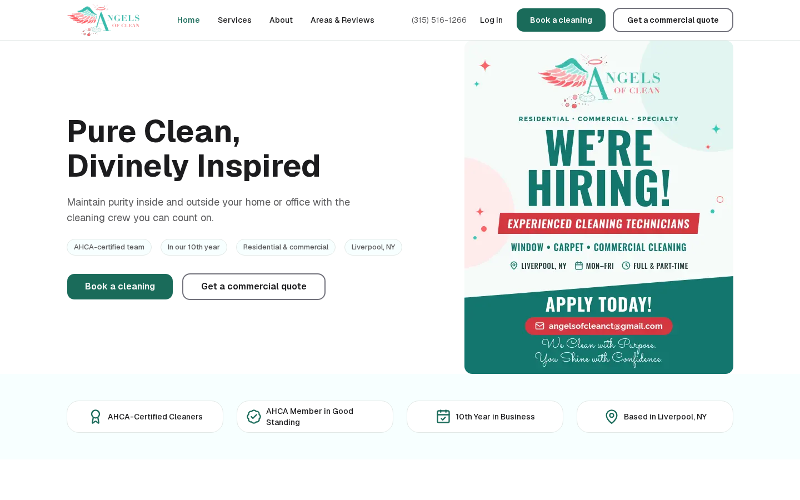
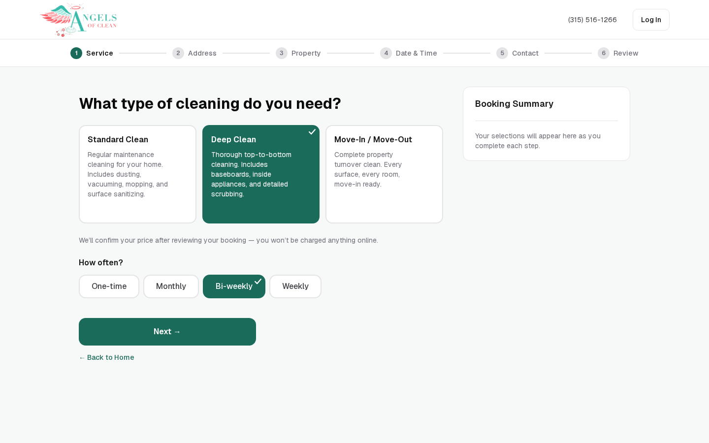
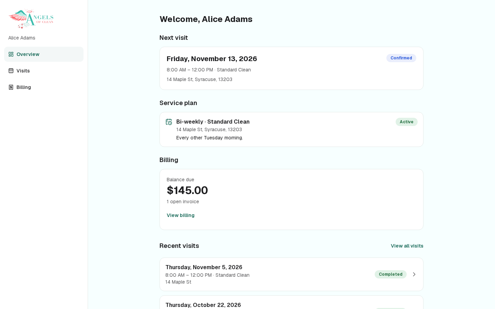
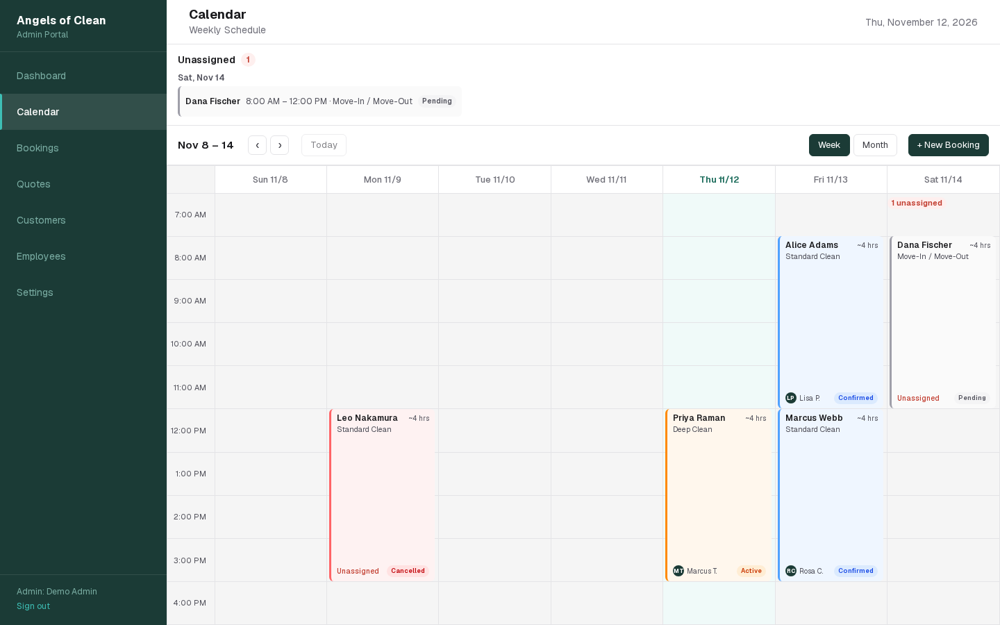
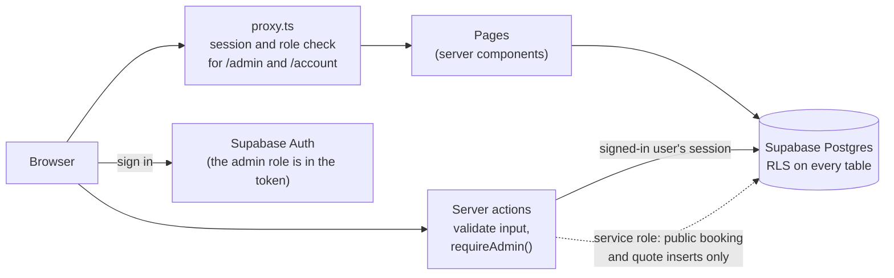

# Angels of Clean

A booking and operations web app for **Angels of Clean**, a residential and commercial cleaning company in the Syracuse, NY area. Customers book a cleaning or request a commercial quote online and follow their visits and invoices in an account portal. The owner and staff run the business from an admin panel with a dashboard, a crew calendar, bookings, quotes and customers.

Built as a course project for **CISY 5233 (Human-Computer Interaction)** for a real small business.

**This is `v2`, the current working version** and the repository's default branch. (`main` is an older snapshot kept for a course write-up. Use `v2`.)



| Booking flow | Customer portal |
|---|---|
|  |  |



_All screenshots come from a local run with invented demo data (see [Run it locally](#run-it-locally-in-about-10-minutes))._

## Features

**For customers**
- Six-step residential booking: service, address, property, date and time, contact details, review. Entry instructions (door codes, pets) are optional and seen only by staff.
- Four-step commercial quote request for offices, clinics, restaurants and other facilities.
- Customer accounts: upcoming and past visits, service plans, invoices and balance. Business accounts add quotes, locations and team invites.
- Four-page marketing site: home, services, about, areas and reviews.

**For staff**
- Dashboard with today's jobs and what needs action.
- Week and month calendar with crew assignment, a list of unassigned jobs and overlap warnings.
- Booking and quote lists, customer records with plans and invoices, and an employee list.
- One booking status flow (pending, confirmed, active, done, cancelled) enforced inside Postgres, with an append-only activity log.

**Throughout**
- All dates and times are New York time, wherever the server or browser is.
- Accessibility target is WCAG 2.2 AA: keyboard operation, visible focus rings and form errors tied to their fields. The brand green is `#1A6B5A`.

## Tech stack

| Layer | Technology |
|---|---|
| Framework | Next.js 16 (App Router, React 19, React Compiler), TypeScript (strict) |
| UI | Tailwind CSS v4, shadcn/ui, FullCalendar |
| State | Zustand (booking wizard, kept in `sessionStorage`) |
| Backend | Supabase: Postgres 17, Auth, row-level security, SQL migrations |
| Tests | Vitest (1525 tests), pgTAP (229 database assertions), ESLint, `tsc` |

## Architecture



Who can see what:

| Who | How they get in | What they can reach |
|---|---|---|
| Visitor | Nothing needed | The marketing site and the booking and quote forms. A form submit is inserted on the server after a honeypot, a minimum fill time and a per-IP rate limit. Visitors have no direct database access. |
| Customer | Email and password, email confirmed | Only their own account's bookings, quotes, plans and invoices, through RLS on account membership. Never crew, staff notes or entry instructions. |
| Admin | `app_metadata.role = 'admin'`, which can only be set server-side | Everything in the admin panel. |

The app lives in [`angels-of-clean/`](angels-of-clean/). For a tour of the code see [`docs/PROJECT_MAP.md`](angels-of-clean/docs/PROJECT_MAP.md), and for the reasoning behind choices see [`docs/DECISIONS.md`](angels-of-clean/docs/DECISIONS.md).

## Run it locally in about 10 minutes

You need **Node 22** and **Docker** (or Podman with its Docker-compatible socket) running. Everything runs on your machine, with no Supabase account needed.

```bash
git clone https://github.com/KaydenCouldBeBetter/angelsofclean.git
cd angelsofclean/angels-of-clean

nvm use                  # Node 22, from .nvmrc (or install Node 22 another way)
npm ci                   # npm may print a peer-dependency warning about eslint-plugin-react; it is harmless

npx supabase start       # starts local Postgres, Auth and Mailpit (first run downloads images)
npx supabase db reset    # applies the migrations, then loads supabase/seed.sql (invented demo data)

# Write .env.local from the running stack (names are listed in .env.example)
npx supabase status -o env | sed -n 's/^API_URL=/NEXT_PUBLIC_SUPABASE_URL=/p;s/^ANON_KEY=/NEXT_PUBLIC_SUPABASE_ANON_KEY=/p;s/^SERVICE_ROLE_KEY=/SUPABASE_SERVICE_ROLE_KEY=/p' > .env.local

npm run dev              # http://localhost:3000
```

**Demo logins.** These accounts exist only in your local database. The seed script creates them, and they are not real accounts. The password for all three is `DemoPass-2026!`.

| Role | Sign in at | Email |
|---|---|---|
| Admin | `/admin` | `demo-admin@example.com` |
| Residential customer | `/login` | `demo-customer@example.com` |
| Business customer (team owner) | `/login` | `demo-business@example.com` |

New sign-ups need to confirm their email. Locally, those emails land in Mailpit at http://127.0.0.1:54324.

**Tests** (run from `angels-of-clean/`)

```bash
npm test                 # Vitest, about 15 seconds
npm run lint
npx tsc --noEmit

# Database tests need an unseeded database:
npx supabase db reset --no-seed && npx supabase test db
npx supabase db reset    # afterwards, bring the demo data back
```

Stop the local stack with `npx supabase stop`.

## Main URLs and project layout

| URL | What it is |
|---|---|
| `/`, `/services`, `/about`, `/areas` | Marketing site |
| `/residential` | Six-step residential booking |
| `/commercial` | Four-step commercial quote request |
| `/signup`, `/login`, `/account` | Customer accounts and the portal |
| `/admin` | Admin sign-in, then dashboard, calendar, bookings, quotes, customers, employees |
| `/privacy`, `/terms` | Legal pages (drafts) |

```
angels-of-clean/
  app/         pages, layouts and server actions (Next.js App Router)
  components/  shared UI
  lib/         business logic, Supabase clients, date and time helpers
  store/       booking wizard state
  supabase/    migrations, seed.sql, config.toml and the pgTAP database tests
  proxy.ts     route guard for /admin and /account
  docs/        PROJECT_MAP.md (code tour) and DECISIONS.md (design reasoning)
```

Day-to-day commands, from `angels-of-clean/`: `npm run dev`, `npm run build`, `npm test`, `npm run lint` and `npx tsc --noEmit`. Schema changes are new migrations in `supabase/migrations/` and are never edits to an applied one. The developer reference is [`angels-of-clean/README.md`](angels-of-clean/README.md).

## Security model

- **Admin access** needs `app_metadata.role = 'admin'`. It is checked in three places: the proxy, `requireAdmin()` at the top of every admin server action, and row-level security in the database. Being signed in is never enough, because public sign-up is open.
- **Customers** read only their own account's rows. RLS decides this inside Postgres, so a bug in the app cannot widen it.
- **The service-role key** is server-only and is used only for the public booking and quote inserts and the rate limiter.
- **Public forms** are guarded by a honeypot, a minimum fill time and a per-IP rate limit (a keyed hash of the IP, never the IP itself).
- **Inputs** are validated in the server actions and again by CHECK constraints in the database. Responses carry a content security policy and the usual hardening headers.
- **Email confirmation** is required before a customer account is linked to bookings made with that email.

## Known limitations

- **No email yet.** There is no domain or outbound email, so there are no booking confirmation emails. Sign-in emails use Supabase's built-in sender.
- **Availability is not real yet.** The booking calendar offers fixed morning and afternoon windows, and one offered day is a hard-coded "Full" placeholder. There is no crew-capacity model yet.
- **No employee app yet.** Staff see their work in the admin panel only. A mobile app for crews is planned.
- **No online payments.** Invoices are shown to customers, who are told to call to pay.
- **Legal pages are drafts.** `/privacy` and `/terms` carry visible placeholders until the owner supplies the final details.

## License and credits

**All rights reserved.** This repository is shared for portfolio and grading only. The Angels of Clean name, logo and photos belong to Angels of Clean and may not be reused.

Built by Kayden Streiff. Business content, brand and photos: Angels of Clean. Built on Next.js, Supabase, shadcn/ui, Tailwind CSS and FullCalendar.
